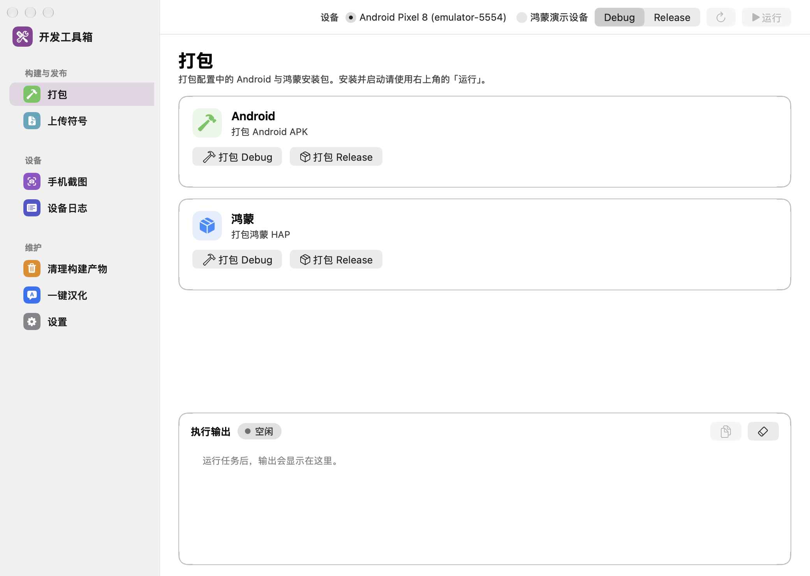

# Developer Toolbox

[简体中文](README.md) | English

**Write code with Agents. Run on real devices with Developer Toolbox.**

A lightweight macOS menu bar & desktop utility for Android and HarmonyOS developers. After editing code, pick a connected device to build, install, and launch your app—or take a screenshot and inspect logs by package name—without keeping Android Studio or DevEco Studio open in the background.

> [!NOTE]
> The app itself is lightweight, while project builds still rely on your local toolchains and SDKs (Gradle / JDK / Android SDK or DevEco Studio / Hvigor).



*Screenshot of the public release UI; devices shown at the top are demo entries.*

---

## Features

- **Build & Run on Real Devices**
  - Trigger **Android (APK)** and **HarmonyOS (HAP)** Debug / Release builds, then install and launch directly from the top bar.
  - Build artifacts standalone and reveal them in Finder when you only need to share a package.
  - Quickly summon the main window from a persistent macOS menu bar icon.
- **Screenshots & Device Logs**
  - **Device Screenshot**: Capture the connected device screen straight to your clipboard, with an option to save the latest capture to Desktop.
  - **Device Logs**: Stream live `logcat` and `hilog` output, filter by app (`package:mine`), tag, log level, or keyword, and bookmark frequent filters.
- **Artifact Inventory & Safe Cleanup**
  - **History Inventory**: Read-only scan of historical build output directories and disk usage.
  - **Safe Cleanup**: Preview reclaimable directories first and move eligible items to **Trash** only after confirmation (never `rm -rf`).
- **Release & Productivity Utilities**
  - **Symbol Upload**: Upload Bugly mapping files by app version.
  - **One-Click Localization**: Install the community Chinese patch for matching Antigravity versions.
  - **Antigravity Update**: Query the latest official build, upgrade the client, and re-apply the patch. The patch changes the code signature, so the built-in auto-updater stops working—use this feature for later upgrades.

---

## Requirements

- **OS**: macOS 13 or later
- **Build Tools**: Xcode Command Line Tools with Swift 5.9+ (`xcode-select --install`)
- **Platform Toolchains (as needed)**:
  - Android: JDK (defaults to Java 21, overridable via `JAVA_HOME`) and Android SDK (`~/Library/Android/sdk/platform-tools/adb`)
  - HarmonyOS: DevEco Studio (uses tools inside `/Applications/DevEco-Studio.app`) and corresponding SDKs

---

## Quick Start

### 1. Build from Source

```sh
git clone https://github.com/LeonShannon/developer-toolbox-macos.git
cd developer-toolbox-macos
./build.sh
open 开发工具箱.app
```

`build.sh` compiles `Sources/*.swift`, ad-hoc signs the app bundle, and runs a self-check.

> [!IMPORTANT]
> Keep `开发工具箱.app` in the same directory as the `.command` and `.sh` scripts in this repository.

### 2. Try Device Tools Without Configuration

To try **Device Screenshot** or **Device Logs** right away, connect an authorized device via USB and open the app. The helper scripts automatically look up common SDK locations as well as `adb` and `hdc` in `PATH`.

---

## Project Configuration

Copy the template to create your local configuration:

```sh
cp -n toolbox.example.plist toolbox.local.plist
open -e toolbox.local.plist
```

Save your changes and reopen the app to refresh actions. Use absolute paths or `~/` for project directories, and relative paths (from each project root) for artifact directories. Leave unused fields empty.

### Minimal Setup

- **Android**
  1. Set `AndroidProject` to the project root containing `gradlew` (e.g. `~/Projects/ExampleAndroid`).
  2. Set `AndroidPackage` to your application ID (e.g. `org.example.android`).
  3. Standard `:app` modules can start with the default `AndroidDebugTask` and `AndroidDebugMetadata` values in the template.
- **HarmonyOS**
  1. Set `HarmonyProject` to your DevEco Studio project root.
  2. Fill in `HarmonyPackage`, `HarmonyAbility`, and `HarmonyModule` (for example, `entry@default` when module is `entry` and target is `default`).
  3. Set `HarmonyDebugProduct` and `HarmonyDebugHap` to match the signed HAP generated by DevEco Studio.

Validate plist syntax after editing, then test a standalone build before running on a device:

```sh
plutil -lint toolbox.local.plist
```

<details>
<summary>Full Configuration Reference (click to expand)</summary>

| Key | Purpose |
| --- | --- |
| `AndroidProject`, `AndroidPackage` | Android project root and application ID (required for app launch and `package:mine` log filtering). |
| `AndroidDebugTask`, `AndroidReleaseTask`, `AndroidDebugMetadata`, `AndroidReleaseMetadata` | Gradle tasks and relative `output-metadata.json` paths (single-APK output currently supported). |
| `AndroidChannelTask`, `AndroidChannelDirectory`, `AndroidMappingDirectory` | Optional channel repackaging task, channel output directory, and mapping directory. |
| `HarmonyProject`, `HarmonyPackage`, `HarmonyAbility`, `HarmonyModule` | HarmonyOS project root, bundle name, launch ability, and Hvigor module. |
| `HarmonyDebugProduct`, `HarmonyReleaseProduct`, `HarmonyDebugHap`, `HarmonyReleaseHap` | Debug / Release product names and signed HAP relative paths. |
| `ExtraProject` | Optional third project path used only for history inventory and cleanup. |
| `AndroidCleanupDirectories`, `HarmonyCleanupDirectories`, `ExtraCleanupDirectories` | Rebuildable relative directories per project (empty by default). |
| `AndroidHistoryDirectories`, `HarmonyHistoryDirectories`, `ExtraHistoryDirectories` | Artifact directories to inspect in read-only history inventory. |

</details>

### Cleanup Guardrails

Cleanup only moves a directory group to Trash when **all** of the following checks pass:

1. The project path is a valid Git worktree root.
2. Candidate files are ignored by `.gitignore` and untracked by Git.
3. The entire group has been unmodified for more than **21 days**.
4. You review the preview and confirm explicitly.

---

## Bugly Symbol Upload

```sh
cp -n bugly.example.sh bugly.local.sh
chmod 600 bugly.local.sh
```

Fill in your Bugly App ID, App Key, package name, and the absolute path to the Bugly upload JAR in `bugly.local.sh`. `INPUT_MAPPING` can point to your default mapping path.

> [!TIP]
> `toolbox.local.plist`, `bugly.local.sh`, `antigravity.local.sh`, and compiled binaries are already listed in `.gitignore`.

---

## Antigravity Update Setup

The update and re-patch flow on the **Antigravity** page depends on an external patcher (a GPL-3.0 project that is *not* bundled here; it is only invoked as a separate process):

```sh
cp -n antigravity.example.sh antigravity.local.sh
chmod 600 antigravity.local.sh
```

Point `TOOLBOX_ANTIGRAVITY_PATCHER` in `antigravity.local.sh` at the patcher's `source` directory (it must contain a working `.venv`). When it is missing, the feature reports the problem and leaves everything else untouched.

> [!NOTE]
> The patch replaces the client's code signature, so the built-in auto-updater stops working; use this page for later upgrades. The previous build is kept in `~/Library/Application Support/开发工具箱/Antigravity/` for rollback.

---

## Repository Structure

```text
.
├── Sources/                     # Swift source files for menu bar & main window
├── 开发工具箱.app/               # macOS app bundle (compiled output from ./build.sh)
├── build.sh                     # Build, ad-hoc codesign, and self-check script
├── toolbox.example.plist        # Project config template (copy to toolbox.local.plist)
├── bugly.example.sh             # Bugly config template (copy to bugly.local.sh)
├── antigravity.example.sh       # Patcher path template (copy to antigravity.local.sh)
├── toolbox-config.sh            # Shared config loader for shell scripts
├── *.command                    # Underlying task scripts (also runnable standalone)
└── docs/images/                 # Screenshots referenced by README
```

---

## Feedback & Issues

Issues are welcome via [GitHub Issues](https://github.com/LeonShannon/developer-toolbox-macos/issues). Please include your macOS version, the feature used, reproduction steps, and relevant output logs—making sure to redact secrets, local paths, device serials, and sensitive log lines before posting.

---

## License

[MIT](LICENSE)
