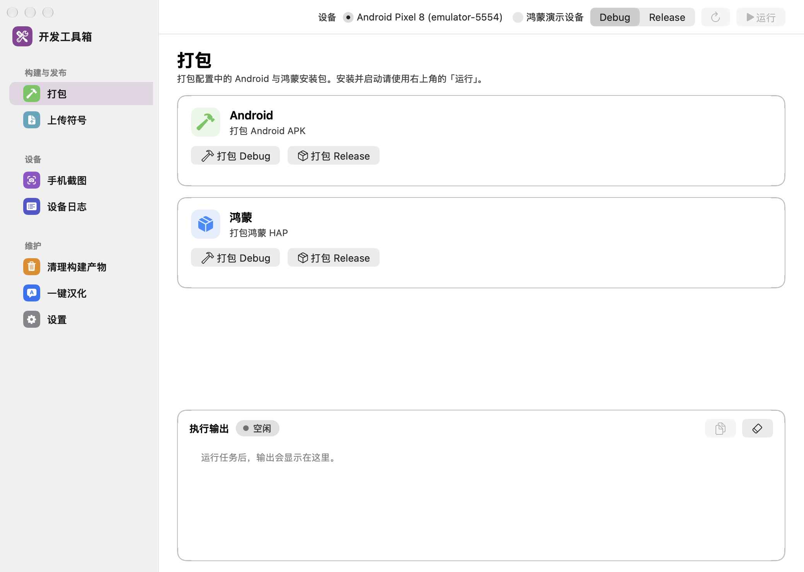

# 开发工具箱 (Developer Toolbox)

简体中文 | [English](README.en.md)

**用 Agent 写代码，用工具箱跑真机。**

改完代码，从 Mac 菜单栏或工具窗口选一台 Android / 鸿蒙设备，一键打包、安装并启动。遇到问题，顺手截屏或按包名查日志。日常真机验证无需常开 Android Studio 或 DevEco Studio，省下大量常驻内存。

> [!NOTE]
> 工具箱本身轻量，但项目打包仍需本机已安装对应的构建工具和 SDK（Gradle / JDK / Android SDK 或 DevEco Studio / Hvigor）。



*公开版界面实拍，顶部设备为演示数据。*

---

## 核心功能

- **打包与真机运行**
  - 支持 **Android (APK)** 和 **鸿蒙 (HAP)** 的 Debug / Release 打包，并在右上角一键安装、拉起应用。
  - 只想发包时，可单独打包并在 Finder 中直接定位产物。
  - 支持通过 Mac 菜单栏常驻图标快速唤起主窗口。
- **手机截图与设备日志**
  - **手机截图**：一键截取当前连接设备画面并自动复制到剪贴板，也支持将上一次截图保存到桌面。
  - **设备日志**：实时查看 `logcat` 与 `hilog`，支持按应用（`package:mine`）、标签、日志级别或关键词筛选，常用筛选条件可收藏复用。
- **构建产物盘点与清理**
  - **历史产物盘点**：只读统计各项目历史产物目录的大小与分布。
  - **安全清理**：先预览可清理目录与预计释放空间，**二次确认后才移入废纸篓**（不直接 `rm`）。
- **发布与效率杂活**
  - **上传符号**：按版本上传 Bugly Mapping 文件。
  - **一键汉化**：为匹配版本的 Antigravity 安装社区中文补丁。

---

## 环境要求

- **系统**：macOS 13 或更新版本
- **编译环境**：包含 Swift 5.9+ 的 Xcode Command Line Tools（可通过 `xcode-select --install` 安装）
- **目标平台依赖（按需）**：
  - Android：JDK（默认使用 Java 21，可通过 `JAVA_HOME` 指定）与 Android SDK（`~/Library/Android/sdk/platform-tools/adb`）
  - 鸿蒙：DevEco Studio（`/Applications/DevEco-Studio.app` 内置工具链）及对应 SDK

---

## 快速开始

### 1. 从源码构建并启动

```sh
git clone https://github.com/LeonShannon/developer-toolbox-macos.git
cd developer-toolbox-macos
./build.sh
open 开发工具箱.app
```

`build.sh` 会自动编译 `Sources/*.swift`、对本地应用签名并运行自检。

> [!IMPORTANT]
> 应用依赖仓库内的辅助脚本，请保持 `开发工具箱.app` 与仓库中的 `.command` / `.sh` 脚本位于同一目录。

### 2. 先体验设备功能（免配置）

如果你只想先试用「手机截图」或「设备日志」，只需用 USB 连接已开启调试授权的真机，打开应用即可直接使用。脚本会自动查找常见安装路径及 `PATH` 中的 `adb` 和 `hdc`。

---

## 配置自己的项目

需要打包、运行或清理自己的工程时，先从模板复制一份本地配置：

```sh
cp -n toolbox.example.plist toolbox.local.plist
open -e toolbox.local.plist
```

编辑完成后保存，重新打开应用即可生效。**路径规范**：项目目录使用绝对路径或 `~/` 开头，产物路径填写相对于项目目录的路径；不用的功能留空即可。

### 最小配置指引

- **Android 项目**
  1. 将 `AndroidProject` 指向包含 `gradlew` 的项目根目录（如 `~/Projects/ExampleAndroid`）。
  2. 将 `AndroidPackage` 填为实际的 Application ID（如 `org.example.android`）。
  3. 标准 `:app` 模块可直接沿用模板中的 `AndroidDebugTask` 和 `AndroidDebugMetadata`。
- **鸿蒙项目**
  1. 将 `HarmonyProject` 指向 DevEco Studio 工程根目录。
  2. 填写 `HarmonyPackage`、`HarmonyAbility` 和 `HarmonyModule`（例如模块为 `entry`、目标为 `default` 时填 `entry@default`）。
  3. 填写 `HarmonyDebugProduct` 与 `HarmonyDebugHap`（以 DevEco Studio 实际生成的已签名 HAP 路径为准）。

修改后建议用系统工具检查 plist 语法是否正确，再在工具箱中先测试「单独打包」，确认能定位到产物后再连接设备点击「运行」：

```sh
plutil -lint toolbox.local.plist
```

<details>
<summary>查看完整配置字段说明（点击展开）</summary>

| 配置项 | 用途 |
| --- | --- |
| `AndroidProject`、`AndroidPackage` | Android 项目根目录及应用包名（安装运行和 `package:mine` 日志筛选依赖包名）。 |
| `AndroidDebugTask`、`AndroidReleaseTask`、`AndroidDebugMetadata`、`AndroidReleaseMetadata` | Gradle 打包任务及对应的 `output-metadata.json` 相对路径（当前支持单 APK 输出）。 |
| `AndroidChannelTask`、`AndroidChannelDirectory`、`AndroidMappingDirectory` | 可选的渠道重打包任务、渠道包输出目录和 Mapping 目录。 |
| `HarmonyProject`、`HarmonyPackage`、`HarmonyAbility`、`HarmonyModule` | 鸿蒙项目根目录、包名、启动 Ability 和 Hvigor 模块标识。 |
| `HarmonyDebugProduct`、`HarmonyReleaseProduct`、`HarmonyDebugHap`、`HarmonyReleaseHap` | Debug / Release 对应的 product 名称与已签名 HAP 相对路径。 |
| `ExtraProject` | 可选的第三个项目路径，仅用于历史产物盘点与清理。 |
| `AndroidCleanupDirectories`、`HarmonyCleanupDirectories`、`ExtraCleanupDirectories` | 各项目可安全重建的相对目录列表（默认留空）。 |
| `AndroidHistoryDirectories`、`HarmonyHistoryDirectories`、`ExtraHistoryDirectories` | 各项目需要盘点占用的产物目录列表（只读）。 |

</details>

### 清理安全护栏

为防止误删源码或未提交修改，自动清理仅在**同时满足以下所有条件**时才会将目录移入废纸篓：

1. 项目路径为有效的 Git 工作树根目录。
2. 候选文件已被 `.gitignore` 忽略且未被 Git 跟踪。
3. 整组文件超过 **21 天**未修改。
4. 经过预览列表并由你手动确认。

---

## 配置 Bugly 符号上传

```sh
cp -n bugly.example.sh bugly.local.sh
chmod 600 bugly.local.sh
```

在 `bugly.local.sh` 中填入你自己的 Bugly App ID、App Key、包名以及上传工具 JAR 的绝对路径，`INPUT_MAPPING` 可设为默认 Mapping 路径。上传脚本会通过命令行参数将密钥传给 Bugly JAR。

> [!TIP]
> `toolbox.local.plist`、`bugly.local.sh` 以及编译生成的二进制文件均已写入 `.gitignore`，不会意外提交到仓库。

---

## 目录结构

```text
.
├── Sources/                     # Swift 菜单栏与主窗口源码
├── 开发工具箱.app/               # macOS 应用包结构（./build.sh 编译输出至此）
├── build.sh                     # 编译、本地签名与自检脚本
├── toolbox.example.plist        # 项目配置模板（复制为 toolbox.local.plist 使用）
├── bugly.example.sh             # Bugly 上传配置模板（复制为 bugly.local.sh 使用）
├── toolbox-config.sh            # 供脚本读取配置的公共逻辑
├── *.command                    # 各功能对应的底层执行脚本（也可在终端/Finder 单独运行）
└── docs/images/                 # README 截图资源
```

---

## 反馈与贡献

欢迎通过 [Issues](https://github.com/LeonShannon/developer-toolbox-macos/issues) 反馈问题或建议。提交 Issue 时请附上：

- macOS 版本与使用的具体功能
- 复现步骤与相关的「执行输出」内容

> 提交前请务必脱敏，移除密钥、本机绝对路径、设备序列号及业务日志中的敏感信息。

---

## License

[MIT](LICENSE)
